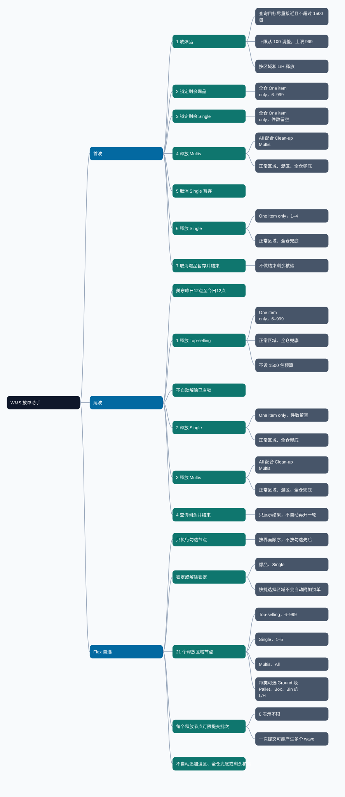
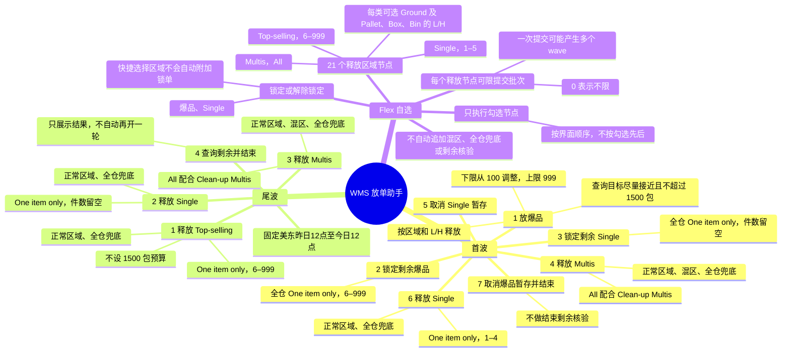
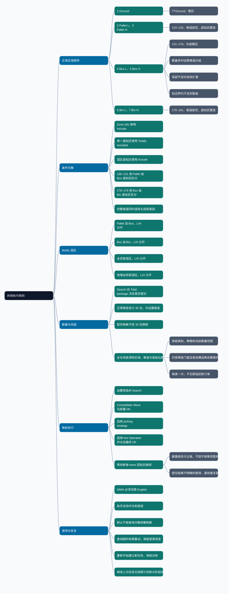
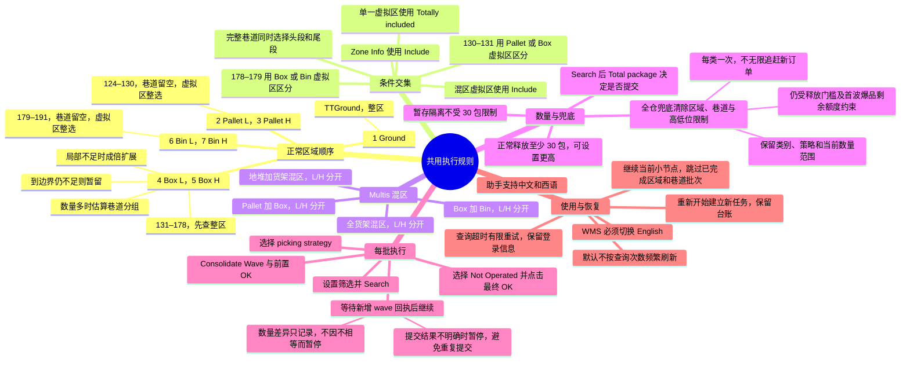

# WMS Wave Assistant v0.8.1

**v0.8.1 正式版。** Windows x64，中文 / Español。EXE 包含 Python 和 Chromium；桌面窗口需要 Edge WebView2 Runtime。EXE 尚未代码签名，Smart App Control 可能拦截；本次功能更新不解决签名问题。

## v0.8.1 更新

- 取消悬浮监控与托盘隐藏；关闭主窗口真正退出。Windows 使用进程树作业对象，异常退出时系统清理所属浏览器子进程，不影响其他浏览器。
- 尾波直接 Top-selling → Single → Multis → 剩余核验，不自动解除旧锁。
- 尾波所有查询（包括兜底和核验）固定 Outbound order created at 为美东昨日 12:00 至今日 12:00；跨午夜续跑不改变该轮范围。旧任务续跑保留旧计划，新范围需新建尾波。
- 波次表 Reset 后等待旧请求结束再 Search，避免迟到结果覆盖新波次。
- Flex 同时勾选解锁与锁定时先解除所选旧锁；锁定无可用包裹明确显示未创建，并提示可能的 Single 锁占用。不会自动解除未勾选的锁。

## 台账复盘修复

- 新建 Flex 与继续旧任务分离。旧取消操作重新读取为 Created 时保留锁单，新 Flex 不被旧首波取消流程阻塞；继续任务仍从原节点执行。
- 新任务准备期间保持所选模式，不再因旧台账跳回首波。
- 主窗口显示 Top-selling / Single 锁单完整 Wave #、包裹数和最后记录状态；手工操作后的当前状态以 WMS 为准。
- 保存逐动作时间线、提交查询快照和完成时间；成功后清除历史错误。
- 爆品先查 6–999，全量在预算内时省去逐级门槛试探。
- 查询 Total package 与实际成波数量偏差仍需现场核对；本版不保证实际波次恰好达到目标或最低包裹数。

## v0.8.1 新功能

- Flex 每个释放区域可设置目标包裹数：0 不限，30–1000000 为目标。按实际波次累计，暂停后保留进度；超过余额的范围会二分巷道，无法再拆则留置。Ground 无巷道可拆。实时订单变化可能使实际数量超过目标。
- 黑底、青红错位的原创 W 图标，用于 EXE 和工作台。
- 本次正式版包含 v0.8.1 测试版功能及后续台账复盘修复。自动测试不等于生产 WMS 的实单验证。

## v0.8.1 恢复与页面等待修复

- 已在汇波页时等待页面加载，不因 Reset 短暂消失重新导航。
- 英文判断使用实际表单，不依赖页眉语言按钮；区分页面未就绪、中文界面和登录过期。
- 每个区域、高低位、Box 巷道批次保存进度。刷新或重新打开助手后，点击“继续当前小节点”；已成功的小节点不会重跑。
- 提交结果尚未返回时先接收该次结果，成功后自动进入下一批，避免重复提交。
- 旧版任务没有保存巷道断点，无法还原旧版未记录的位置；精确小节点恢复适用于本版记录的进度。

## 放单逻辑思维导图 · v0.8.1

以下描述 **v0.8.1 正式版**。下载请使用 [GitHub Release v0.8.1](https://github.com/DongChenGG/GUC_WaveConsolidation/releases/tag/v0.8.1)，规则不适用于旧版任务的续跑计划。

### 首波、尾波与 Flex

节点前的编号表示执行顺序；L 是低位，H 是高位。

[打开大图](wave-plans.svg)

展开 Mermaid 源码

### 分区、数量门槛与执行方式

[打开大图](wave-rules.svg)

展开 Mermaid 源码

**阅读边界：**

- 首波／尾波的三种类型都会先分区域与高低位；只有后面的全仓兜底放开这些限制。Flex 不放开到未勾选区域。
- “至少 30 包”限制的是本次查询量，不保证 WMS 拆出的每个 wave 都至少 30 包；首波 1500 也只是查询预算，动态订单可能使实际数量不同。
- 尾波 Single 件数留空，因此可能包含未放出的或新进入的爆品；Flex Single 当前固定为 1–5。
- 文中的“释放”指选择策略、Not Operated、最终 OK 并取得新增波次回执，不包含随后在 Wave Confirmation 上再点另一道确认按钮。
- 自动取消只针对本机台账记录、当前账号与仓库的暂存波次；重新开始不会清空 WMS。旧任务续跑仍使用旧计划。
- 尾波核验会展示剩余，不保证清空所有订单；小于门槛的余量可以保留。定时配置当前仍是提醒，不是无人值守启动。

## 开始

关闭旧版，运行 v0.8.1并登录 WMS。**WMS 网页必须切换为 English**，助手本身可用中文或西语。运行中不要使用同一账号在其他窗口创建或取消波次。

首波和尾波现在是固定流程。点击“开始运行”新建一轮并保留已有波次与台账；点击“继续上次任务”继续原版本的计划和进度（包括旧次波）。新任务不再提供次波。未决提交先核对结果，避免重复提交。

## 首波

1. 按区域、L/H 释放 Top-selling，查询目标尽量接近且不超过 1500 包（6–999 范围内，从 100 起调整下限）。
2. 锁定剩余爆品（全仓 One item only，6–999）。
3. 锁定 Single（全仓 One item only，不限制 Package quantity）。
4. 分区、L/H 释放 Multis，使用 All + Clean-up Multis 合并三种类型。
5. 解除本程序记录的 Single 锁定。
6. 分区、L/H 释放 Single，Package quantity **1–4**。
7. 解除本程序记录的爆品锁定，结束。**不查询剩余包裹。**

1500 是查询预算，不是 WMS 实际生成数量的精确承诺；动态订单和策略过滤会导致差异。低于释放门槛或超过剩余预算的批次留置，不为了凑数循环追单。

## 尾波

Top-selling 6–999 → Single（One item only，**Package quantity 留空**）→ Multis → 查询并记录剩余包裹后结束。

尾波的 Single 不按件数排除爆品；按照用户指定的先 Top-selling 后 Single 顺序运行。所有查询固定在本轮保存的美东昨日中午到今日中午，截单后订单排除。已有锁不自动解除，可在 Flex 中明确选择。

## Flex 自选放单

固定首波/尾波的自选节点功能移到 Flex：
- 锁定 / 解除锁定：全仓锁爆品、锁 Single、解除已记录的爆品或 Single 锁定，按界面显示顺序执行。
- 释放区域：Top-selling / Single / Multis 各自可选 Ground、Pallet L/H、Box L/H、Bin L/H，共 21 个独立节点。
- Top-selling 使用 6–999；Single 使用 1–5；Multis 使用 All + Clean-up Multis。
- **只处理勾选区域，不自动进行全仓兜底或剩余核验。** 无选项时不能启动。
- 每个释放区域可设置提交批次上限，0 不限；一次提交可能生成多个波次。达到后进入下个所选区域。
- 快捷按钮只选择释放区域，不自动附加锁单或解锁。订单仍处于锁定状态时，需要明确选择对应解锁动作。
- 锁 Single 没有数量范围，可能包含未隔离的爆品；锁定顺序为先爆品后 Single。先执行明确勾选的解锁动作，再锁爆品、锁 Single，最后释放区域。

## Box 先大后小查询

每个 Box L/H、类型先查询整区（Zone Info 留空，只选虚拟区）。总量少于 30 时留置；稀疏且达到门槛时整区释放。总量大时按总量估算分组，密集区保持至少配置的完整巷道数（默认 3）。局部不足 30 时成倍扩大范围，不再一次增加一个巷道。每个范围的实际 Search 数量才用于提交判断；估算不作为包裹分配保证。

Pallet / Bin 直接整区 L/H。Box 边界使用 130–131 和 178–179 巷道，通过虚拟区取交集。单区域 Totally included，混区 Include。释放至少 30 包（配置更高时遵守更高值），暂存隔离不受该门槛限制。

首波/尾波每类分区释放后保留分类和该阶段数量范围做一次全仓兜底；Flex 不进行范围外兜底。实际 WMS 波次可能小于查询数，记录差异但不据此重复提交。

## 等待、恢复和记录

实时阶段、区域/巷道、查询、提交、回执等待和用时持续显示。回执使用独立标签页，默认不定期刷新。查询超时有界恢复；已提交但结果未知保留 pending。取消只操作本机台账中、当前账号与仓库的暂存波次。数据默认位于 `~/.wms-wave-assistant`，更新不删除台账。导出台账按钮显示实际保存路径。

## Español

Versión oficial v0.8.1. WMS debe estar en **English**. Primera: top hasta 1500 → reservar top → reservar Single → Multis → cancelar reserva Single → Single 1–4 → cancelar reserva top; sin auditoría final. Final: top → Single sin filtro de cantidad → Multis → pendientes. Todas las consultas se limitan a ayer 12:00–hoy 12:00, America/New_York; no cancela reservas automáticamente.

Flex permite seleccionar reservas y zonas Ground / Pallet / Box / Bin, L/H, para Top-selling (6–999), Single (1–5) y Multis. Solo ejecuta las zonas marcadas, sin pasada global. Box consulta primero toda la zona, luego divide por volumen y amplía por duplicación cuando faltan paquetes. Mínimo de consulta: 30. Continuar conserva el plan anterior; iniciar usa el nuevo plan.

## 构建

安装 requirements.txt 后用 `python run.py` 启动源码桌面版。Windows x64 运行 `python build.py`：回归测试 → 打包 EXE → Chromium / 桌面自检。生产 WMS 创建/取消测试未执行。程序内时间配置仍为提醒，不是无人值守定时启动。
